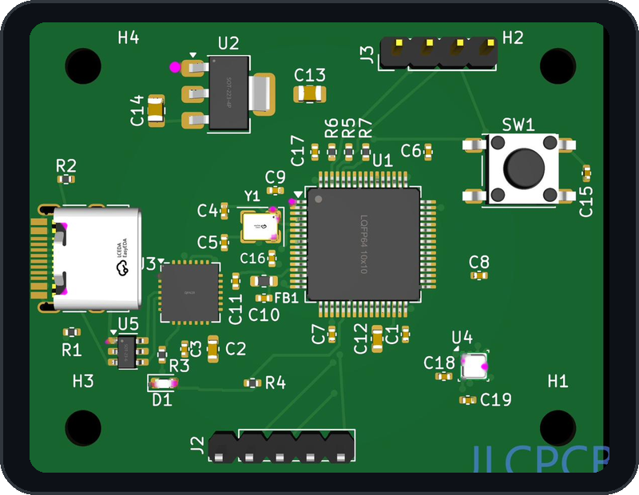
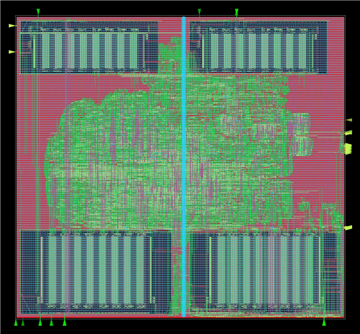
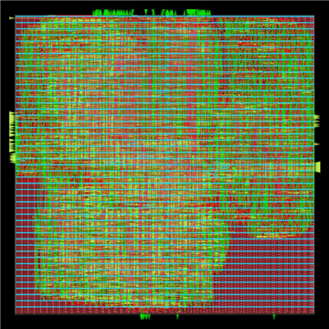

## Muhammad Saad

Electrical engineering at the University of Waterloo. I build across the stack: circuit boards and bare-metal firmware, the software and tools around them, and digital hardware from RTL down to a placed and routed chip layout.

[itssaad50@gmail.com](mailto:itssaad50@gmail.com) &nbsp;·&nbsp; [portfolio-saad.com](https://portfolio-saad.com) &nbsp;·&nbsp; Looking for Summer 2027 internships in embedded systems, software, and ASIC / digital design

### Projects

<table>
<tr>
<td width="200"></td>
<td><b><a href="https://github.com/saadafsy/stm32-sensor-pcb">stm32-sensor-pcb</a></b> &nbsp;KiCad · bare-metal C · CMSIS · FreeRTOS · Python 
A custom 4-layer STM32F411 sensor board with register-level firmware (no HAL) and a FreeRTOS pipeline. A BME280 and an OLED share one I²C bus; readings stream as CRC-framed packets to a live Python viewer. 
<b>4-layer</b> PCB designed in KiCad &nbsp;·&nbsp; <b>921600</b> baud telemetry &nbsp;·&nbsp; CRC-checked framing</td>
</tr>
<tr>
<td></td>
<td><b><a href="https://github.com/saadafsy/p1-attention">p1-attention</a></b> &nbsp;SystemVerilog · cocotb · SymbiYosys · OpenROAD · Vivado 
A fixed-point attention accelerator (one transformer attention head) with a 4x4 MAC array and an online softmax that never stores the score matrix. Bit-exact against a golden model, formally verified, laid out in sky130 with four SRAM macros. 
<b>79.4 MHz</b> sky130 signoff, 0 DRC &nbsp;·&nbsp; <b>19.9</b> MAC/cycle &nbsp;·&nbsp; <b>21.8x</b> faster than optimized C on a RISC-V core &nbsp;·&nbsp; placed and routed, not taped out</td>
</tr>
<tr>
<td></td>
<td><b><a href="https://github.com/saadafsy/p2-riscv-soc">p2-riscv-soc</a></b> &nbsp;SystemVerilog · C firmware · UVM · riscv-formal · OpenROAD 
A 5-stage RV32IM RISC-V SoC with APB peripherals, JTAG debug, RAM self-test, C firmware built with clang, and the attention accelerator on AXI4-Lite in its own clock domain. Every instruction checked against a Python ISS. 
<b>119.8 MHz</b> core signoff &nbsp;·&nbsp; riscv-formal <b>52/52</b> &nbsp;·&nbsp; <b>2.27</b> CoreMark/MHz &nbsp;·&nbsp; full SoC meets timing in Vivado</td>
</tr>
</table>

### Tools

**Embedded**: C, bare-metal ARM (STM32, CMSIS), FreeRTOS, KiCad, UART / I²C / SPI 
**Software**: Python, C++, TypeScript, Git, Linux, Tcl, Perl 
**Digital hardware**: SystemVerilog, VHDL, cocotb, UVM, SVA, SymbiYosys, Yosys, OpenSTA, OpenROAD (sky130), Vivado
